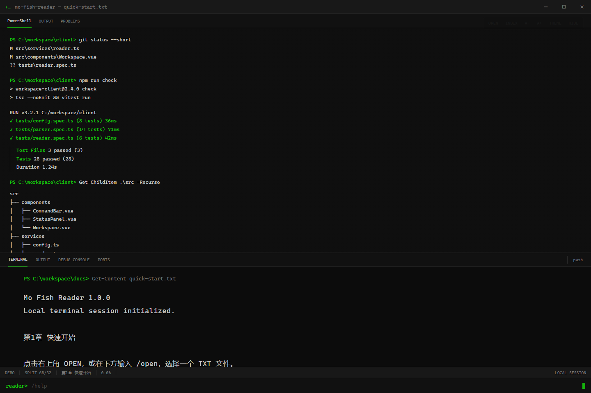

# Mo Fish Reader

一个本地优先、模仿真实工作终端的 TXT 阅读器，适合上班时低调阅读。正文直接运行在 PowerShell/Windows Terminal 中，上半区展示工作区、Git、进程、日志或只读 Codex 会话，降低完整小说页面带来的视觉暴露。Vue/Tauri 版本作为图形界面实验原型保留。

当前稳定版本：`v1.0.0`。



## PowerShell 原生模式（推荐）

不启动浏览器，也不使用 localhost。小说直接绘制在当前 PowerShell 或 Windows Terminal 窗口中：

```powershell
.\reader.ps1 "D:\小说\示例.txt"
```

如果系统提示禁止执行 `.ps1`，直接使用附带的启动器。它会优先调用 PowerShell 7；如果没有安装，则自动回退到系统自带的 Windows PowerShell，并只为本次进程临时放宽执行策略：

```powershell
.\mo-fish-reader.cmd "D:\小说\示例.txt"
```

不传路径时直接进入书架：

```powershell
.\mo-fish-reader.cmd
```

旧入口 `fish-reader.cmd` 继续保留，已有启动命令无需立即修改。

`shelf` 目录中的 TXT 会在进入书架时自动递归扫描，不需要逐本添加。在书架中输入 `A` 也可添加单个 TXT 或整个目录；直接用路径启动的小说同样会自动加入书架。索引只保存路径和元数据，不复制、移动或重命名原文件。

固定正文显示行数：

```powershell
.\mo-fish-reader.cmd "D:\小说\示例.txt" -ReaderLines 10
```

| 操作 | 按键 |
| --- | --- |
| 下一页 | `Space`、`PageDown`、`↓`、`→` |
| 上一页 | `B`、`PageUp`、`↑`、`←` |
| 增加/减少正文行数 | `+` / `-` |
| 切换上方工作视图 | `W` |
| 手动刷新工作视图 | `R`；等待阅读时页面不会自动刷新 |
| 全文搜索 | `/` 输入关键词；`N/P` 跳到下一个/上一个结果；`Esc` 清除搜索 |
| 多书签 | `K` 打开书签管理；可添加、跳转、重命名或删除 |
| 更换 Codex session | `S` 打开最近会话列表；`Enter` 切换，`/` 筛选，`P` 手动粘贴 UUID |
| 章节目录 | `C` 打开，`↑/↓` 选择，`Enter` 跳转，`N/P` 翻页，`Esc` 返回 |
| 上一章/下一章 | `[` / `]` |
| 返回书架 | `L`；选书后切换，取消则回到当前小说 |
| 完全隐藏正文 | `Esc` |
| 打开另一本 TXT | `O` |
| 首页/末页 | `Home` / `End` |
| 退出 | `Q` |

阅读页底部会固定显示状态行和完整快捷键栏，无需记忆或返回说明文档查询按键。快捷键会根据 PowerShell 窗口宽度自动合并或换行；拖动改变窗口宽高时只在尺寸变化后重排，不会恢复定时刷新。

阅读位置会自动保存到：

```text
%LOCALAPPDATA%\FishReader\progress.json
```

再次打开同一路径的小说时会自动续读。启动参数 `-Chapter` 的优先级高于已保存进度。

全文搜索按当前小说执行，不区分大小写；全部命中使用黄色背景，当前命中使用青色背景，状态栏显示当前结果和总数。多书签按小说内容关联，即使 TXT 移动到其他目录仍可识别，数据保存在 `%LOCALAPPDATA%\FishReader\bookmarks.json`。

章节索引会按小说内容、文件修改时间和终端宽度缓存到 `%LOCALAPPDATA%\FishReader\cache.json`。同一本大文件再次打开时可以直接复用目录索引；当前进程还会保留最近 3 个排版结果，往返切书或调整后恢复宽度时无需重复计算。

书架支持两种浏览模式：

- `BOOKS`：按书名罗列所有小说，同时显示作者、阅读进度、收藏和阅读状态。
- `AUTHORS`：先选择作者，再进入该作者的子级书目。

书架还提供 `ALL`、`RECENT`、`READING`、`FAVORITES`、`UNREAD`、`FINISHED` 六个分类。按 `V` 循环切换分类，`F` 收藏/取消收藏，`X` 在自动判断、未读和已完成之间切换状态。`N/R/D` 分别表示未读、阅读中和已完成，`*` 表示收藏。列表会根据终端宽度裁剪列，窄窗口优先保留书名、进度和状态。

书架使用即时按键交互，快捷键不需要回车：`M` 在两种模式之间切换，`↑/↓` 移动高亮，`Enter` 打开小说或进入作者，`B` 返回作者列表，`N/P` 或 `PageDown/PageUp` 翻页，`Q` 退出。数字 `1`～`9` 也可直接快速选择前 9 项。只有 `A` 添加路径和 `/` 搜索需要输入文本后回车。

作者识别优先级如下：

1. 作者目录，支持 `shelf\刘慈欣\三体.txt` 和 `001 - 刘慈欣(Cixin Liu)` 这类编号目录。
2. 文件名中的 `作者：某人`，例如 `《诡秘之主》作者：爱潜水的乌贼.txt`。
3. 无法识别时归入“未知作者”。

书架索引数据保存在：

```text
%LOCALAPPDATA%\FishReader\library.json
```

书架按键：`↑/↓` 选择、`Enter` 打开、`M` 切换模式、`V` 切换分类、`F` 收藏、`X` 调整状态、`A` 添加文件或目录、`N/P` 翻页、`D` 请求移出当前高亮项的索引、`/` 搜索、`Q` 退出。按 `D` 后会显示书名和作者，只有再按 `Y` 才确认，其他任意键均取消。移出索引不会删除 TXT 原文件；位于 `shelf` 内的文件会在下次扫描时再次出现，如需彻底移除，请手动移走原文件。

上半区默认显示所选 Codex session 的只读对话镜像；按 `W` 可在 `CODEX`、`ACTIVITY`、`GIT`、`PROCESS` 和 `LOG` 视图之间切换。等待阅读时页面不会自动刷新，翻页或按 `R` 时才会读取最新状态。`PROCESS` 会查找命令行中引用当前工作区的真实进程，并同时列出项目配置中的可用任务。

终端区域使用接近 PowerShell/PSReadLine 的语义配色：提示符为绿色、命令名为黄色、参数为青色、字符串为紫色、路径为浅蓝色；Codex 标题、`USER` 和 `CODEX` 标签也会与正文分色。

在阅读中按 `S` 会打开最近 Codex 会话列表，显示更新时间、项目名和最近一条可见用户消息。用方向键选择、`Enter` 切换、`/` 搜索，或按 `P` 粘贴 UUID。阅读器会验证本地 session 是否存在；成功后立即打开新的 `CODEX` 视图，并将选择保存到 `%LOCALAPPDATA%\FishReader\settings.json`，下次启动继续使用。也可以使用可选启动参数 `-CodexSessionId <UUID>` 临时覆盖本次启动。

`CODEX` 视图只读本机会话记录，只显示用户和助手的可见文本；不会启动或恢复 Codex、不会发送消息、不会执行工具，也不会写入 session 文件。首次启动不会预设任何 session，按 `S` 从本机最近会话中选择。

日常使用时不需要额外参数；普通工作视图默认监看 `mo-fish-reader` 项目自身。

```powershell
.\mo-fish-reader.cmd "D:\小说\示例.txt"
```

`-WorkRoot` 只是可选的高级用法；只有想改为监看另一个开发项目时才需要它：

```powershell
.\mo-fish-reader.cmd "D:\小说\示例.txt" -WorkRoot "D:\workspace\my-project"
```

如果项目有持续写入的日志，可以让 `LOG` 视图直接跟踪该文件：

```powershell
.\mo-fish-reader.cmd "D:\小说\示例.txt" -WorkRoot "D:\workspace\my-project" -WorkLog "D:\workspace\my-project\logs\dev.log"
```

要在启动时直接打开某个视图，可使用 `-WorkView Codex|Activity|Git|Process|Log`。

阅读器只读取工作区、Git 状态、项目配置和日志，不会自动执行项目脚本或修改项目文件。

## 隐私与数据边界

- 小说正文、书架索引、进度、书签和设置只保存在本机，不会上传到项目仓库或网络服务。
- `CODEX` 视图仅在用户主动选择 session 后读取本机 `.codex\sessions` 中的可见对话文本，并保持只读。
- 仓库通过 `.gitignore` 排除 `shelf` 内的小说、构建产物、依赖目录和临时状态文件。
- 工作视图可能显示当前工作区的文件名、Git 状态、进程命令行或日志；在录屏、直播或共享终端前请切换到合适视图。

## License

本项目采用 [MIT License](LICENSE)。

也可以启动时直接跳到识别出的第 100 个章节：

```powershell
.\mo-fish-reader.cmd "D:\小说\示例.txt" -Chapter 100
```

## 当前功能

- 打开或拖入 `.txt`、`.log`、`.md`
- 自动识别 UTF-8、UTF-16 和 GB18030
- 自动保存每本书的滚动进度
- 动态生成章节目录，支持“第一章”、“1. 标题”、“2．标题”和“27 标题”等格式
- SSH、PowerShell、浅色日志三种皮肤
- 字号与行距调节
- `/open`、`/chapter`、`/theme`、`/font` 等终端命令
- `Esc` 显示安全屏，桌面版使用 `Alt+反引号` 全局隐藏/恢复
- 数据保存在本机，不包含网络请求

## 浏览器图形原型

```powershell
npm install
npm run dev
```

打开终端显示的本地地址即可。浏览器安全限制下，重新启动后需要再次选择 TXT 文件，但阅读进度仍会保留。

## Windows 桌面版

先安装 Rust 和 Windows C++ 构建工具，然后运行：

```powershell
npm install
npm run tauri dev
```

生成安装包：

```powershell
npm run tauri build
```

## 快捷操作

| 操作 | 快捷键 / 命令 |
| --- | --- |
| 翻页 | `Space`、`Shift+Space`、`PageUp`、`PageDown` |
| 切换章节 | `[`、`]` |
| 聚焦命令行 | `Ctrl+P` |
| 安全屏 | `Esc` 或 `/clear` |
| 恢复正文 | `/resume` |
| 桌面快速隐藏 | `Alt+反引号` |

## 下一阶段

- 超大 TXT 分块读取和虚拟渲染
- 书签备注导出与跨设备同步
- 搜索历史和正则搜索
- 自定义全局快捷键
- 便携版 Windows 构建
